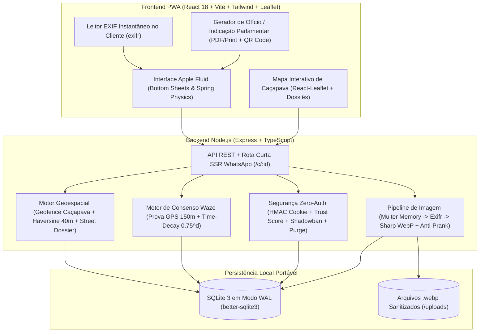

# 01 — Arquitetura do Sistema, Stack Tecnológica e Banco de Dados (`taiada-fiscaliza`)

---

## 1. Visão Geral da Arquitetura

O `taiada-fiscaliza` é arquitetado como uma aplicação Full-Stack em TypeScript de alta performance e zero dependências de serviços pagos externos, pronta para ser executada localmente ou em qualquer servidor VPS/container Open Source.



---

## 2. Estrutura de Diretórios do Projeto

```text
taiada-fiscaliza/
├── GEMINI.md                                 # Constituição obrigatória para todos os agentes/sessões
├── .agents/skills/apple-design/SKILL.md      # Skill oficial Apple Design (emilkowalski/skills)
├── docs/                                     # Memória arquitetural viva e ADRs
│   ├── 00-INDEX.md
│   ├── 01-ARCHITECTURE-AND-STACK.md
│   ├── 02-DESIGN-SYSTEM-APPLE-TAIADA.md
│   ├── 03-GEO-CONSENSUS-AND-SECURITY.md
│   ├── 04-API-AND-VIRAL-ENGINE.md
│   └── 05-AGENT-EXECUTION-PLAN.md
├── public/
│   ├── manifest.json                         # Manifesto PWA (Taiada Fiscaliza / Cobra, Taiada!)
│   └── favicon.svg                           # Emblema vetorial Verde Taiada (#15301d -> #347947)
├── src/
│   ├── config/
│   │   ├── brand.ts                          # Configuração oficial dupla ('Taiada Fiscaliza' / 'Cobra, Taiada!') + Paleta
│   │   └── env.ts                            # Validação Zod de variáveis de ambiente (Zero Segredos no código)
│   ├── shared/
│   │   ├── types.ts                          # Interfaces compartilhadas (Issue, Vote, StreetDossier, Category, etc.)
│   │   ├── categories.ts                     # As 8 categorias, regras de foto obrigatória/opcional e níveis 1..5
│   │   └── geo.ts                            # Geofence de Caçapava (3508504), Haversine, street_group_key e catálogo de vias
│   ├── server/
│   │   ├── index.ts                          # Entrada do servidor Express + integração Vite/Static + SSR /c/:id
│   │   ├── db/
│   │   │   ├── index.ts                      # Conexão better-sqlite3 em modo WAL + inicialização de schema
│   │   │   ├── schema.ts                     # DDL completo das 5 tabelas e índices
│   │   │   └── seed.ts                       # Seed automático com 8 casos realistas em ruas de Caçapava
│   │   ├── middleware/
│   │   │   └── deviceIdentity.ts             # Cookie assinado taiada_device_token (HMAC-SHA256) + device_hash
│   │   ├── services/
│   │   │   ├── geoService.ts                 # Busca de duplicatas (<=40m) e agregação de Dossiês de Rua
│   │   │   ├── imagePipeline.ts              # Extração EXIF seletiva + sanitização Sharp WebP + heurística de entropia
│   │   │   ├── consensusEngine.ts            # Cálculo de pesos GPS, teto remoto (3.0), Time-Decay e máquina de estados
│   │   │   ├── securityService.ts            # Filtro de autor, cálculo de trust_score, Shadowban, Expurgo e Webhook
│   │   │   └── ogGenerator.ts                # Geração de HTML OpenGraph e imagem SVG dinâmica para WhatsApp
│   │   └── routes/
│   │       ├── issues.ts                     # GET /api/issues, POST /api/issues/check-duplicates, POST /api/issues, etc.
│   │       ├── admin.ts                      # POST /api/admin/moderation/:id, POST /api/admin/purge-device, GET /api/admin/queue
│   │       └── share.ts                      # GET /c/:id e GET /api/og/:id.svg
│   ├── components/
│   │   ├── BrandLogo.tsx                     # Detecção automática de /logo.svg ou /logo.png + fallback vetorial Apple
│   │   ├── HeaderBar.tsx                     # Topo translúcido (#15301d / vidro fosco), filtros, busca e atalhos
│   │   ├── MapCanvas.tsx                     # Mapa Leaflet de Caçapava, pinos customizados, destaque de Dossiê e ajuste fino
│   │   ├── FluidBottomSheet.tsx              # Bottom Sheet com física de mola, velocity handoff e projeção Apple
│   │   ├── CreateIssueSheet.tsx              # Fluxo de 3 etapas, leitura EXIF, 4 modos de localização e card de fusão 40m
│   │   ├── IssueDetailSheet.tsx              # Detalhes do pino, votação Waze com GPS, galeria EXIF e linha do tempo
│   │   ├── StreetDossierDrawer.tsx           # Painel de Dossiês de Rua (ex: Avenida Brasil com pinos numerados)
│   │   ├── OfficialDocumentModal.tsx         # Gerador de Ofício / Indicação Parlamentar pronto para impressão/PDF + QR Code
│   │   ├── WhatsAppShareModal.tsx            # Card viral "Feito para o Zap" com link curto /c/TAI-2026-XXXX
│   │   ├── SettingsModal.tsx                 # Seletor de marca, Temas (Claro/Escuro/Sol Forte), Economia 3G/4G e Dados Locais
│   │   ├── AdminModerationModal.tsx          # Painel de moderação, protocolo oficial, Expurgo em 1 Clique e Shadowban
│   │   └── PrivacyBanner.tsx                 # Banner discreto LGPD + Modal de Termos e Privacidade sem rastreadores
│   ├── context/
│   │   └── AppPreferencesContext.tsx         # Estado persistido (BrandMode, ThemeMode, DataSaver, DefaultView)
│   ├── App.tsx                               # Orquestração principal da interface
│   ├── main.tsx                              # Ponto de entrada React
│   └── index.css                             # Design tokens CSS (--taiada-dark, --taiada-primary), estilos Apple e @media print
├── tests/
│   └── api.test.ts                           # Testes automatizados (Geofence, Haversine 40m, EXIF, Consenso Waze, Expurgo)
├── .env.example                              # Template documentado de variáveis de ambiente
├── README.md                                 # Documentação pública Open Source
├── CONTRIBUTING.md                           # Guia de contribuição
├── SECURITY.md                               # Política de divulgação de vulnerabilidades
├── LICENSE                                   # Licença MIT
├── package.json
├── tsconfig.json
└── vite.config.ts
```

---

## 3. Variáveis de Ambiente Validadas (`src/config/env.ts`)

Nenhum segredo pode ser fixado no código-fonte. O módulo `src/config/env.ts` valida via `zod`:

| Variável | Descrição | Padrão Seguro em Dev (Sem segredos de prod) |
| :--- | :--- | :--- |
| `PORT` | Porta HTTP do servidor unificado | `3000` |
| `NODE_ENV` | Ambiente de execução (`development`, `production`, `test`) | `development` |
| `DATABASE_PATH` | Caminho do arquivo SQLite (`.db`) | `./data/taiada-fiscaliza.db` |
| `UPLOADS_DIR` | Diretório onde as fotos `.webp` sanitizadas são salvas | `./data/uploads` |
| `DEVICE_SECRET` | Segredo HMAC-SHA256 para assinar o cookie `taiada_device_token` | Gerado de forma efêmera em dev se ausente; obrigatório em `production` |
| `ADMIN_TOKEN` | Token de autorização do painel `/admin` (comparado via `timingSafeEqual`) | Obrigatório para habilitar ações administrativas |
| `VITE_APP_BRAND_MODE` | Modo inicial da marca: `'institucional'` (`Taiada Fiscaliza`) ou `'imperativo'` (`Cobra, Taiada!`) | `'institucional'` |
| `PUBLIC_BASE_URL` | URL base pública para montagem das metatags OpenGraph do WhatsApp | `http://localhost:3000` |
| `WEBHOOK_URL` | URL opcional (Discord / Telegram) para alertas de moderação em tempo real | *(vazio / opcional)* |

---

## 4. Schema Completo do Banco de Dados SQLite (`WAL`)

Na inicialização (`src/server/db/index.ts`), o banco executa:
```sql
PRAGMA journal_mode = WAL;
PRAGMA synchronous = NORMAL;
PRAGMA foreign_keys = ON;
```

### 4.1. DDL das Tabelas (`src/server/db/schema.ts`)

```sql
-- 1. Tabela Principal de Demandas (Pinos)
CREATE TABLE IF NOT EXISTS issues (
  id TEXT PRIMARY KEY,                        -- Ex: 'TAI-2026-0104'
  title TEXT NOT NULL,
  description TEXT NOT NULL,
  category TEXT NOT NULL,                     -- 'buracos_vias' | 'iluminacao' | 'limpeza_mato' | 'calcadas_acessibilidade' | 'sinalizacao_transito' | 'saude' | 'educacao' | 'transporte'
  severity INTEGER NOT NULL CHECK(severity BETWEEN 1 AND 5),

  -- Campos Auxiliares Condicionais por Categoria (JSON ou texto estruturado)
  auxiliary_data TEXT,                        -- JSON: { pole_number?, health_unit?, approx_time?, school_name?, bus_line? }

  -- Localização Bruta Original + Localização Final Ajustada pelo Usuário
  raw_latitude REAL,
  raw_longitude REAL,
  latitude REAL NOT NULL,
  longitude REAL NOT NULL,
  street_name TEXT NOT NULL,                  -- Ex: 'Avenida Brasil'
  street_group_key TEXT NOT NULL,             -- Ex: 'avenida-brasil::buracos_vias' (Para Dossiê de Rua)
  neighborhood TEXT NOT NULL,                 -- Ex: 'Vera Cruz'
  reference_point TEXT,                       -- Ex: 'Em frente à Escola X / UBS Y'
  location_source TEXT NOT NULL,              -- 'gps_live' | 'photo_exif' | 'search_address' | 'manual_pin'
  gps_accuracy_meters REAL,

  -- Metadados Seletivos de Auditoria EXIF (Apenas Data e Coordenada da Foto)
  photo_url TEXT,                             -- Caminho do arquivo .webp limpo (100% sem dados de hardware)
  exif_captured_at TEXT,                      -- Data/hora extraída do EXIF (NULL se ausente)
  exif_latitude REAL,                         -- Latitude bruta do EXIF (NULL se ausente)
  exif_longitude REAL,                        -- Longitude bruta do EXIF (NULL se ausente)
  exif_distance_meters REAL,                  -- Distância entre EXIF e pino final (NULL se ausente)
  exif_verified_local INTEGER DEFAULT 0,      -- 1 se o EXIF bateu com o local em Caçapava (<= 250m do pino)

  -- Autor e Segurança Anti-Spam
  author_name TEXT,                           -- NULL se anônimo
  device_hash TEXT NOT NULL,
  trust_score INTEGER NOT NULL DEFAULT 70,
  moderation_status TEXT NOT NULL DEFAULT 'auto_approved', -- 'auto_approved' | 'pending_review' | 'approved' | 'rejected'
  is_shadowbanned INTEGER NOT NULL DEFAULT 0,

  -- Status de Resolução (Comunidade Waze + Gabinete Oficial)
  resolution_status TEXT NOT NULL DEFAULT 'open', -- 'open' | 'verifying_resolution' | 'resolved_community' | 'reopened' | 'resolved_official'
  official_status TEXT NOT NULL DEFAULT 'received', -- 'received' | 'triaged' | 'protocolled' | 'completed'
  official_protocol_number TEXT,              -- Ex: 'Indicação Nº 142/2026 - Câmara de Caçapava'

  -- Contadores e Score Ponderado
  upvotes_count INTEGER NOT NULL DEFAULT 1,
  consensus_score REAL NOT NULL DEFAULT 0.0,  -- Saldo calculado pela equação Time-Decay + GPS
  reopened_count INTEGER NOT NULL DEFAULT 0,  -- Quantas vezes o problema voltou após resolvido

  created_at INTEGER NOT NULL,
  updated_at INTEGER NOT NULL
);

CREATE INDEX IF NOT EXISTS idx_issues_street_group ON issues(street_group_key);
CREATE INDEX IF NOT EXISTS idx_issues_coords ON issues(latitude, longitude);
CREATE INDEX IF NOT EXISTS idx_issues_device ON issues(device_hash);

-- 2. Tabela de Votos e Validações Estilo Waze (Com Prova de Presença GPS)
CREATE TABLE IF NOT EXISTS issue_votes (
  id INTEGER PRIMARY KEY AUTOINCREMENT,
  issue_id TEXT NOT NULL REFERENCES issues(id) ON DELETE CASCADE,
  device_hash TEXT NOT NULL,
  vote_type TEXT NOT NULL,                    -- 'upvote' | 'resolved_yes' | 'resolved_no_returned'
  voter_latitude REAL,
  voter_longitude REAL,
  distance_to_issue_meters REAL,              -- Distância calculada via Haversine no momento do voto
  is_presential_gps INTEGER NOT NULL DEFAULT 0, -- 1 se distance <= 150m
  has_proof_photo INTEGER NOT NULL DEFAULT 0,
  proof_photo_url TEXT,
  vote_weight REAL NOT NULL,                  -- 5.0 (GPS+Foto), 3.0 (GPS), 0.5 (Remoto)
  note TEXT,                                  -- Comentário curto opcional (máx 140 chars)
  is_shadowbanned INTEGER NOT NULL DEFAULT 0,
  created_at INTEGER NOT NULL
);

CREATE INDEX IF NOT EXISTS idx_votes_issue ON issue_votes(issue_id, created_at);
CREATE INDEX IF NOT EXISTS idx_votes_device ON issue_votes(device_hash);

-- 3. Tabela de Contribuições Agrupadas (Fusão de Raio Curto <= 40m - Seção 3.2 Opção A)
CREATE TABLE IF NOT EXISTS issue_contributions (
  id INTEGER PRIMARY KEY AUTOINCREMENT,
  issue_id TEXT NOT NULL REFERENCES issues(id) ON DELETE CASCADE,
  device_hash TEXT NOT NULL,
  author_name TEXT,
  note TEXT,
  photo_url TEXT,
  exif_captured_at TEXT,
  exif_verified_local INTEGER DEFAULT 0,
  is_shadowbanned INTEGER NOT NULL DEFAULT 0,
  created_at INTEGER NOT NULL
);

CREATE INDEX IF NOT EXISTS idx_contributions_issue ON issue_contributions(issue_id, created_at);

-- 4. Linha do Tempo de Auditoria e Transparência do Chamado
CREATE TABLE IF NOT EXISTS issue_timeline (
  id INTEGER PRIMARY KEY AUTOINCREMENT,
  issue_id TEXT NOT NULL REFERENCES issues(id) ON DELETE CASCADE,
  event_type TEXT NOT NULL,                   -- 'created' | 'merged_support' | 'waze_verifying' | 'waze_resolved' | 'waze_reopened' | 'official_protocol'
  title TEXT NOT NULL,
  description TEXT,
  created_at INTEGER NOT NULL
);

CREATE INDEX IF NOT EXISTS idx_timeline_issue ON issue_timeline(issue_id, created_at);

-- 5. Dispositivos Banidos / Shadowban (Defesa Anti-Troll)
CREATE TABLE IF NOT EXISTS blocked_devices (
  device_hash TEXT PRIMARY KEY,
  reason TEXT,
  shadowban INTEGER NOT NULL DEFAULT 1,
  created_at INTEGER NOT NULL
);
```

---

## 5. Especificação do Seed Realista de Caçapava (`src/server/db/seed.ts`)

Ao iniciar pela primeira vez com banco vazio, o sistema popula automaticamente **8 demandas realistas** em coordenadas reais de Caçapava - SP:

| Protocolo | Categoria | Rua e Bairro (Caçapava - SP) | Coordenadas (`Lat, Lng`) | Status / Caso Demonstrado |
| :--- | :--- | :--- | :--- | :--- |
| `TAI-2026-0101` | `buracos_vias` | **Avenida Brasil**, Vera Cruz | `-23.1042, -45.7098` | **Dossiê Avenida Brasil (Ponto #1):** Cratera na faixa da direita sentido Centro, com foto verificada EXIF e 18 apoios. |
| `TAI-2026-0102` | `buracos_vias` | **Avenida Brasil**, Jardim Caçapava | `-23.1018, -45.7081` | **Dossiê Avenida Brasil (Ponto #2):** Afundamento de asfalto próximo ao cruzamento (~310m do #1), 16 apoios. |
| `TAI-2026-0103` | `buracos_vias` | **Avenida Brasil**, Centro / Vila São João | `-23.0989, -45.7062` | **Dossiê Avenida Brasil (Ponto #3):** Sequência de buracos junto à sarjeta (~360m do #2), 14 apoios (Totalizando **48 moradores afetados** no Dossiê da Avenida Brasil!). |
| `TAI-2026-0104` | `iluminacao` | **Rua São Bento**, Vila Resende | `-23.1075, -45.7142` | Poste apagado em frente à praça (`Nº do poste: CP-4812`), Gravidade 4/5, protocolado na Câmara (`Indicação Nº 142/2026`). |
| `TAI-2026-0105` | `sinalizacao_transito` | **Av. Coronel Manoel Inocêncio**, Centro | `-23.1004, -45.7059` | Faixa de pedestre apagada e semáforo de pedestres intermitente em horário de pico, Gravidade 5/5. |
| `TAI-2026-0106` | `saude` | **Rua Dr. José de Moura Resende**, Vila Paraíso | `-23.0945, -45.7015` | Demora no acolhimento e falta de insumo básico na UBS da Vila Paraíso (sem foto obrigatória, com campos auxiliares preenchidos). |
| `TAI-2026-0107` | `buracos_vias` | **Rua Marquês de Herval**, Centro | `-23.0996, -45.7088` | **Caso Reaberto (`reopened`):** Buraco havia recebido reparo paliativo e foi marcado como resolvido, mas reabriu após chuva forte e 3 moradores presenciais contestaram (`reopened_count = 1`). |
| `TAI-2026-0108` | `calcadas_acessibilidade` | **Av. da Saudade**, Parque Residencial Nova Caçapava | `-23.1128, -45.6945` | **Caso em Verificação Comunitária (`verifying_resolution`):** Rampa de cadeirantes que estava quebrada recebeu votos presenciais de reparo ($S = 6,0$), aguardando confirmação final. |
