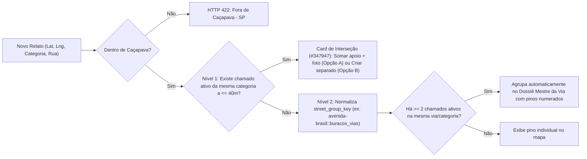

# 03 — Motor Geoespacial, Pipeline EXIF, Consenso Waze e Segurança Anti-Troll (`taiada-fiscaliza`)

---

## 1. Recorte Geográfico Exclusivo: Caçapava - SP (`src/shared/geo.ts`)

- **Município:** Caçapava, Estado de São Paulo, Brasil (Código IBGE: `3508504`).
- **Centro Inicial do Mapa:** `LAT = -23.1006`, `LNG = -45.7069`, `ZOOM = 14`.
- **Bounding Box de Trava Municipal (Geofencing):**
  - `MIN_LAT = -23.2600` | `MAX_LAT = -22.9500`
  - `MIN_LNG = -45.8100` | `MAX_LNG = -45.6000`
- **Regra de Bloqueio:** Qualquer tentativa de submissão ou checagem de duplicatas fora deste retângulo é bloqueada no frontend e rejeitada pelo backend com `HTTP 422 Unprocessable Entity` e mensagem amigável explicando que o **Taiada Fiscaliza / Cobra, Taiada!** atende exclusivamente o município de Caçapava - SP.

### 1.1. Fórmula de Haversine (Distância Exata em Metros)
$$d = 2r \arcsin\left(\sqrt{\sin^2\left(\frac{\Delta \phi}{2}\right) + \cos(\phi_1)\cos(\phi_2)\sin^2\left(\frac{\Delta \lambda}{2}\right)}\right)$$
Onde $r = 6\,371\,000\text{ m}$.

---

## 2. Deduplicação Inteligente em 2 Níveis (`src/server/services/geoService.ts`)

### 2.1. Nível 1: Interceptação de Raio Curto ($\le 40\text{ m}$)
- Busca chamados ativos (`resolution_status NOT IN ('resolved_community', 'resolved_official')` e `moderation_status IN ('auto_approved', 'approved')`) da **mesma categoria** cuja distância Haversine até o ponto informado seja $d \le 40\text{ m}$.
- Se encontrado, o frontend apresenta o card com borda `#347947`:
  > *"Já existe um relato de [Categoria] a [X] metros daqui ('[Título]', com [N] apoios). É o mesmo problema?"*
  - **Opção A (Recomendada — `POST /api/issues/:id/contribute`):** Incrementa `upvotes_count`, registra voto `upvote` para o `device_hash`, salva a foto/comentário adicional em `issue_contributions`, adiciona evento `merged_support` na `issue_timeline` e abre direto o modal de compartilhamento do WhatsApp.
  - **Opção B:** Permite prosseguir e criar um novo protocolo independente.

### 2.2. Nível 2: Dossiê Automático de Rua (`street_group_key`)
- Função `buildStreetGroupKey(streetName: string, category: IssueCategory): string`:
  1. Remove acentos (`NFD` + remoção de diacríticos), converte para minúsculas e remove pontuação;
  2. Padroniza prefixos (`^av\b` / `^av\.\s*` $\rightarrow$ `avenida`, `^r\b` / `^r\.\s*` $\rightarrow$ `rua`, `^pca\b` / `^praca\b` $\rightarrow$ `praca`, `^al\b` $\rightarrow$ `alameda`, `^estr\b` $\rightarrow$ `estrada`, `^rod\b` $\rightarrow$ `rodovia`, `^cel\b` $\rightarrow$ `coronel`, `^dr\b` $\rightarrow$ `doutor`);
  3. Substitui espaços por hífens e concatena `::${category}` (ex: `"Av. Brasil"` + `"buracos_vias"` $\rightarrow$ `"avenida-brasil::buracos_vias"`).
- Sempre que $\ge 2$ relatos ativos compartilham a mesma `street_group_key`, a API retorna um objeto `StreetDossier` em `street_dossiers` contendo:
  - Título formatado: `"Dossiê: [Categoria] na [Nome da Via]"`
  - Quantidade de pontos críticos mapeados (`issues_count`) e soma total de moradores afetados (`total_upvotes` + contribuições)
  - Lista ordenada geograficamente dos pinos numerados (`#1`, `#2`, `#3`...) e polilinha/extensão da via para destaque no mapa e emissão de Ofício Coletivo da Rua.

---

## 3. Pipeline de Imagem, EXIF Seletivo e Heurística Anti-Brincadeira (`src/server/services/imagePipeline.ts`)

1. **Extração Seletiva de Auditoria (`exifr`):**
   - Lê o buffer em memória (`multer.memoryStorage()`) extraindo **exclusivamente**:
     - `DateTimeOriginal` ou `CreateDate` $\rightarrow$ salvo em `exif_captured_at` (ISO 8601).
     - `latitude` e `longitude` $\rightarrow$ salvos em `exif_latitude` e `exif_longitude`.
   - Calcula `exif_distance_meters` até a coordenada final do relato. Se o EXIF estiver dentro de Caçapava e a $\le 250\text{ m}$ do pino, marca `exif_verified_local = 1` (concede bônus de `+15` no `trust_score` e exibe o selo `#347947`: **"Foto verificada no local e data"**).
   - **Tolerância Total:** Se a imagem não tiver EXIF (ex: veio do WhatsApp ou câmera sem GPS), o envio **nunca é bloqueado**.
2. **Sanitização Total e Conversão `.webp` (`sharp`):**
   - Valida os *magic bytes* reais via `sharp(buffer).metadata()`. Rejeita arquivos que não sejam imagens válidas (`jpeg`, `png`, `webp`, `heic`, `avif`).
   - Redimensiona para no máximo `1280x1280` (`fit: 'inside', withoutEnlargement: true`), aplica `.rotate()` (auto-orientação antes de limpar tags) e converte para `.webp({ quality: 80 })` **sem chamar `.withMetadata()`**, removendo 100% dos metadados de hardware, modelo do celular, número de série e dados pessoais do arquivo público salvo em `/uploads`.
3. **Detecção Automática de Fotos Inválidas / Brincadeiras (`sharp.stats()`):**
   - Analisa `stats.entropy`, a média de luminância (`mean`) e o desvio padrão (`stdev`) dos canais RGB:
     - **Escura demais (dedo na lente / bolso):** média de luminância $< 12$ e `stdev < 10`.
     - **Estourada / branca total:** média de luminância $> 248$ e `stdev < 8`.
     - **Lisa / borrada extrema / sem informação visual:** `entropy < 3.2` ou `stdev < 11`.
     - **Print de tela / meme artificial:** razão de aspecto vertical extrema combinada com baixa entropia cromática.
   - Se detectada anomalia, `isSuspiciousImage = true` aplica penalidade `-40` no `trust_score`, enviando o relato para `pending_review` ("Em Revisão pela Moderação") sem poluir o mapa público.

---

## 4. Motor de Consenso Estilo Waze + Decaimento Temporal (`src/server/services/consensusEngine.ts`)

### 4.1. Pesos de Votação com Prova de Presença GPS
Quando um cidadão vota em `resolved_yes` (*"Já foi resolvido"*) ou `resolved_no_returned` (*"Ainda está lá / O problema voltou"*):

| Tipo de Validador | Condição Técnica | Peso ($W_i$) | Direção ($s_i$) | Regra Anti-Sabotagem |
| :--- | :--- | :--- | :--- | :--- |
| **Presencial com Foto Atual** | $d_{\text{voto}} \le 150\text{ m}$ + Foto nova anexada | $5,0$ | $+1$ ou $-1$ | Prova máxima de presença física na rua em Caçapava. |
| **Presencial via GPS** | $d_{\text{voto}} \le 150\text{ m}$ (sem foto) | $3,0$ | $+1$ ou $-1$ | Exige múltiplos aparelhos passando fisicamente na via. |
| **Remoto (Sem GPS ou $> 150\text{ m}$)** | $d_{\text{voto}} > 150\text{ m}$ ou GPS negado | $0,5$ | $+1$ ou $-1$ | **Trava de Teto Remoto:** $\left|\sum \text{votos remotos ponderados}\right| \le 3,0$. Impossível resolver à distância. |

### 4.2. Equação de Decaimento Temporal (Time-Decay)
Para todos os votos válidos (`is_shadowbanned = 0`) de resolução/contestação do chamado:
$$S(t_{\text{agora}}) = \sum_{i \in \text{Presenciais}} s_i \cdot W_i \cdot (0,75)^{\Delta \text{dias}_i} \;+\; \text{clamp}\!\left(\sum_{j \in \text{Remotos}} s_j \cdot 0,5 \cdot (0,75)^{\Delta \text{dias}_j},\; -3,0,\; +3,0\right)$$
Onde $\Delta \text{dias}_i = \max\left(0, \frac{t_{\text{agora}} - t_i}{86\,400\,000}\right)$ (com timestamps em milissegundos).

### 4.3. Máquina de Estados de Resolução Comunitária
1. **`open` (Aberto):** Estado inicial ($S < 4,0$ e nunca esteve em verificação/resolvido).
2. **`verifying_resolution` (Em Verificação Comunitária):** Quando $4,0 \le S < 10,0$ (ou quando $S \ge 10,0$ mas ainda há $< 2$ dispositivos presenciais distintos).
3. **`resolved_community` (Resolvido segundo Moradores):** Quando $S \ge 10,0$ **E** existem pelo menos **$2$ votos presenciais positivos ($d_{\text{voto}} \le 150\text{ m}$)** de `device_hash` distintos.
4. **`reopened` (Reaberto • Problema Recorrente):** Se o chamado estava em `verifying_resolution` ou `resolved_community` (ou já possuía `reopened_count > 0`) e novos votos negativos (`resolved_no_returned`) derrubam $S < 4,0$ **OU** somam $\le -6,0\text{ pontos}$ nas últimas $72\text{ horas}$:
   - Status muda automaticamente para `reopened`;
   - Incrementa `reopened_count = reopened_count + 1` (quando transiciona de `resolved_community` ou `verifying_resolution` para `reopened`);
   - Registra evento `waze_reopened` na `issue_timeline`.

---

## 5. Segurança Zero-Auth, `trust_score`, Optimistic UI e Defesa Anti-Troll (`src/server/services/securityService.ts`)

1. **Identidade Anônima Persistente (`device_hash`):**
   - Cookie `taiada_device_token` contendo `<uuidv4>.<hmac_sha256>` (`HttpOnly`, `SameSite=Lax`, `Secure` em HTTPS, `maxAge: 365 dias`), com fallback de leitura do header `X-Device-Token` persistido no `localStorage`.
   - `device_hash = SHA256(device_id + ":" + ip_subnet + ":" + DEVICE_SECRET).slice(0, 32)`.
2. **Pontuação Automática de Confiança (`trust_score` de $0$ a $100$):**
   - Base inicial: **`70`**
   - `+15` se `location_source === 'gps_live'` dentro de Caçapava com `gps_accuracy_meters <= 50`
   - `+15` se `exif_verified_local === 1`
   - `+10` se o `device_hash` já possui $\ge 1$ relato anterior com `moderation_status IN ('auto_approved', 'approved')`
   - `-40` se a foto falhar na heurística de qualidade (`isSuspiciousImage`)
   - `-35` se o título/descrição/autor tiver caixa alta excessiva ($> 60\%$ maiúsculas), caracteres repetidos ou termos suspeitos
   - `-30` se for o $\ge 3^\circ$ relato do mesmo `device_hash` nos últimos $30\text{ minutos}$
   - **Decisão:** `trust_score >= 60` $\rightarrow$ `auto_approved` (publicação imediata no mapa); `trust_score < 60` $\rightarrow$ `pending_review` (com **Optimistic UI**: visível para o próprio `device_hash` com badge *"Enviado • Em revisão rápida"* e link do WhatsApp liberado).
3. **Expurgo em 1 Clique + Shadowban (`/admin`):**
   - `POST /api/admin/purge-device`: Em uma única transação SQLite:
     1. Insere/atualiza o `device_hash` em `blocked_devices` (`shadowban = 1`);
     2. Remove todos os relatos (`issues`), contribuições (`issue_contributions`) e votos (`issue_votes`) criados por aquele `device_hash` nas últimas $72\text{ horas}$ (ou marca como expurgados);
     3. Recalcula `upvotes_count`, `consensus_score` e `resolution_status` de todos os chamados onde aquele dispositivo havia votado.
   - **Modo Shadowban:** Dispositivos com `shadowban = 1` em `blocked_devices` continuam recebendo `HTTP 200/201` normalmente ao criar relatos ou votar, mas seus registros nascem com `is_shadowbanned = 1` — filtrados de todas as consultas públicas e exibidos **exclusivamente** para o próprio `device_hash`.
